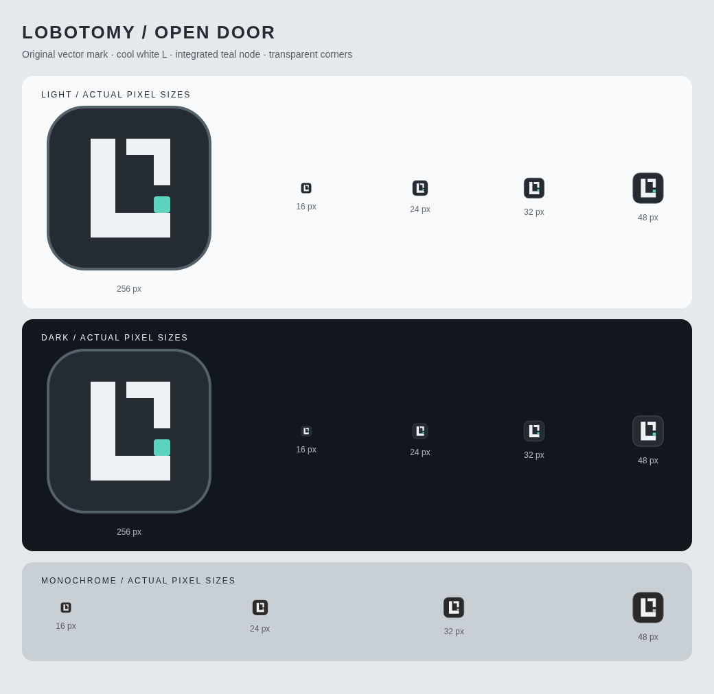

# 程序图标

这是 Lobotomy 的原创软件图标。深灰圆角方形承载冷白 L 和开放的门框；青绿节点位于门框内部，表示工作指示灯。L 的识别不依赖颜色。图标没有使用或描摹 Project Moon／脑叶公司的官方 logo 或游戏素材。



## 资源入口

唯一绘图源是 `frontend/public/icons/lobotomy.svg`。同目录的 PNG 和 ICO 均由它生成，修改时不单独编辑位图。

- Electron 窗口：Windows 使用包含 16、24、32、48、256 px 帧的 ICO；Linux 使用 256 px PNG。
- Electron 托盘：Windows 使用同一个 ICO；其他平台使用 16 px PNG，并附带 1.5×、2×、3×表示。
- 网页 favicon：开发页面和 Vite 构建页面都引用 SVG。Vite 将 `public/icons` 复制到 `dist/icons`，相对 URL 也适用于 Electron 的 `file://` 页面。

仓库目前没有安装包配置。本次不添加安装包或可执行文件图标嵌入流程。macOS 的应用包／Dock 图标不在本次接入范围。

## 重新生成和验证

在 `frontend/` 执行：

```sh
npm ci
npx playwright install chromium
npm run icons:generate -- --preview
npm run icons:check
npm run build
npx playwright test e2e/electron.spec.ts
```

生成脚本复用现有 Playwright，不增加依赖。Windows 默认使用已安装的 Edge，与现有 e2e 配置一致。也可用 `ICON_CHROMIUM_PATH` 指定本机 Chromium。Linux 的 Electron 测试需要图形会话，例如 Xvfb。

`icons:check` 重新渲染 SVG，逐字节检查 PNG 和 ICO；应使用生成时的同一浏览器版本，避免栅格化或 PNG 编码差异。`--preview` 更新本页预览，包含 256 px 大图及 16、24、32、48 px 原尺寸对照。审查图形时需要同时检查浅色、深色、灰度和透明圆角。

## 本次检查

在 Linux 云端环境中，使用 Chromium 151.0.7922.173 渲染并目视检查了预览中的全部尺寸、浅深背景和灰度版本。另检查了 PNG 的透明圆角、ICO 的五个尺寸帧，以及 Vite 构建后的资源复制和相对 favicon URL。

本地 `icons:check`、类型检查、77 个单元测试、生产构建和 3 个 Electron e2e 均通过。Electron 运行检查确认 X11 窗口实际收到 256 px 图标，托盘图像包含四档缩放表示；开发页面和 `file://` 页面均能读取 favicon。云端没有 Windows 桌面，Windows 的窗口／托盘外观仍需实机目视确认。
