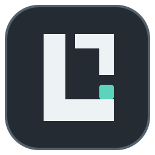

# 程序图标

Lobotomy 的原创图标：深灰圆角方形上是冷白的 L 形门框，门框内的青绿节点表示工作指示灯。L 的识别不依赖颜色。图标没有使用或描摹 Project Moon／脑叶公司的 logo 或游戏素材。

## 资源

唯一的绘图源是 `frontend/public/icons/lobotomy.svg`。改了它之后，在 `frontend/` 运行 `npm run icons:generate`，重新生成同目录的 PNG（16、24、32、48、256 px）和 ICO，并提交生成的文件。不单独编辑位图。脚本用 e2e 测试的同一个浏览器栅格化。

- Electron 窗口：Windows 用 ICO，其他平台用 256 px PNG。
- Electron 托盘：Windows 用 ICO，其他平台用 16 px PNG，附 24、32、48 px 作为高倍表示。
- 网页 favicon：引用 SVG。Vite 把 `public/icons` 复制到 `dist/icons`，相对 URL 在 Electron 的 `file://` 页面中也能用。

仓库还没有安装包配置，所以可执行文件中嵌入的图标和 macOS 的 Dock 图标都没有做。

## 实测结果及待验证

2026-10-12 在 Linux 云端环境（Chromium 151、X11）中确认：窗口收到 256 px 图标，托盘图像有四档表示，开发页面和 `file://` 页面都能读取 favicon。

**待验证**：Windows 上窗口和托盘的实际外观。
